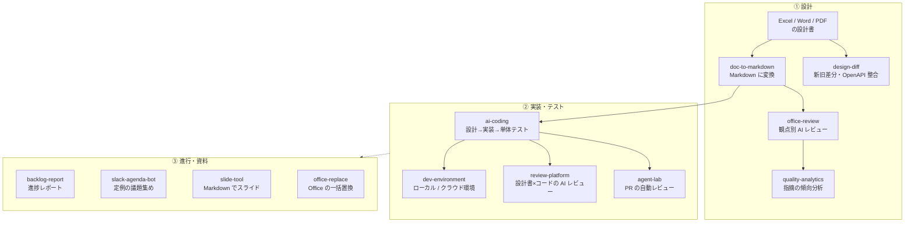
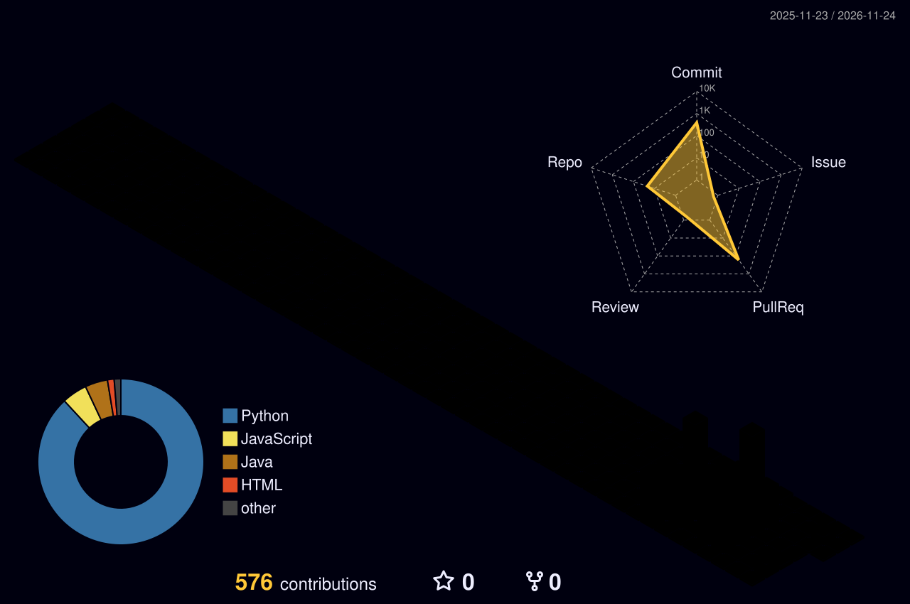

<!-- ヘッダー -->
<p align="center">
  
</p>

<p align="center">
  <a href="https://github.com/shoyo-maya-bot">
    
  </a>
</p>

<p align="center">
  <a href="https://zenn.dev/shoyomayabot"></a>
  <a href="https://qiita.com/maya-bot"></a>
  <a href="https://shoyo-maya-bot.github.io/devtools-workspace/armory/"></a>
  
</p>

---

## 👋 About me

```yaml
role:      システムエンジニア（業務システムの設計・開発）
focus:     [AI エージェント, 設計書の自動化, 単体テスト, クラウド設計]
building:  開発チームがそのまま clone して使える AI 開発ツール群
learning:  [AWS / Azure のアーキテクチャ, LLM アプリの評価と運用]
hobby:     [ゲーム制作, ミステリー小説, 配信]
motto:     "AI の出力は下書き。仕上げは検査で守る"
```

- 🧰 **設計書 → Markdown → レビュー → 実装 → テスト** を AI と回すツールを、汎用版として公開しています
- 📚 AI エンジニア向けと業務開発向けの **教材** を、演習とテスト付きで書いています
- 🎮 クラウドや資格の勉強を **ブラウザゲーム** にしています
- 🔧 セキュリティの CLI・ブラウザの中で動く AI など、**種類の違う小さな道具** も作っています

---

## 🛠️ Tech Stack

<p align="center">
  <br>
  <br>
  
</p>

<h3 align="center">🤖 AI ツール</h3>

| 用途 | ツール |
|---|---|
| 開発・レビュー |                |
| 調べもの・まとめ |         |
| 業務 |       |
| 資料・デザイン |      |
| 画像・3D |    |
| 動画 |        |
| 音声・音楽 |     |

| 分野 | よく使うもの |
|---|---|
| 言語 | Python 3.12 / Java 17 + Spring Boot / TypeScript |
| AI | Claude Code と GitHub Copilot で作り、Codex（codex-plugin-cc）でレビュー（別の AI どうしで相互レビュー）・MCP（Unity / Blender）・Ollama（ローカル LLM）・RAG・transformers.js（ブラウザ内で動く埋め込みモデル） |
| インフラ | Docker Compose（ローカル）・Terraform（AWS / Azure）・GitHub Actions・GitHub Pages・Cloudflare Workers + D1・Chrome 拡張（MV3）・PWA・Leaflet（地図） |
| 品質 | pytest / JUnit・ruff・bandit・pip-audit・CodeQL・gitleaks・依存のハッシュ固定 |

---

## 🧰 devtools — 開発チーム向け AI ツール群

設計書づくりからレビュー・実装・テスト・会議運営まで、**15 のリポジトリを組み合わせて使う** ツール群です。
親リポジトリの [devtools-workspace](https://github.com/shoyo-maya-bot/devtools-workspace) から一括で取り込めます。
使いたい道具だけを選ぶなら、RPG 風の [**devtools 武具屋**](https://shoyo-maya-bot.github.io/devtools-workspace/armory/) で「装備」すると取り込み用のスクリプトが出ます。



| 段階 | リポジトリ | ひとことで |
|---|---|---|
| 設計 | [doc-to-markdown](https://github.com/shoyo-maya-bot/doc-to-markdown) | Office / PDF / draw.io を Markdown に。YAML から draw.io の図も作る |
| 設計 | [office-review](https://github.com/shoyo-maya-bot/office-review) | 観点とマルチロールで設計資料をレビューし、指摘を蓄積 |
| 設計 | [design-diff](https://github.com/shoyo-maya-bot/design-diff) | Excel 設計書の新旧差分と、API 定義書と OpenAPI の整合チェック |
| 設計 | [quality-analytics](https://github.com/shoyo-maya-bot/quality-analytics) | レビュー指摘を「欠陥・ノイズ・確認／観点／真因」に分けて傾向を出す |
| 実装 | [ai-coding](https://github.com/shoyo-maya-bot/ai-coding) | AI と進める設計→実装→単体テスト→レビューの手順と品質ゲート |
| 実装 | [dev-environment](https://github.com/shoyo-maya-bot/dev-environment) | docker compose と Terraform の環境、Spring Boot のサンプルアプリ |
| 実装 | [review-platform](https://github.com/shoyo-maya-bot/review-platform) | 設計書とコードの差分を AI でレビュー。ローカル・AWS・Azure で同じコード |
| 実装 | [agent-lab](https://github.com/shoyo-maya-bot/agent-lab) | MCP・自律度・複数モデルの相互レビューの実験と、PR の自動レビュー |
| 運営 | [backlog-report](https://github.com/shoyo-maya-bot/backlog-report) | Backlog の遅延・担当者別・バーンダウンを Slack と Wiki へ |
| 運営 | [slack-agenda-bot](https://github.com/shoyo-maya-bot/slack-agenda-bot) | `/agenda` で議題を集めて Canvas にまとめる Slack ボット |
| 運営 | [slide-tool](https://github.com/shoyo-maya-bot/slide-tool) | Marp + Tailwind。レイアウト 20 種・はみ出しチェック・PDF / PPTX |
| 運営 | [office-replace](https://github.com/shoyo-maya-bot/office-replace) | Excel / Word / PowerPoint の文字列・シート名・ファイル名を一括置換 |
| 共通 | [devtools-common](https://github.com/shoyo-maya-bot/devtools-common) | 終了コード・レポート形式・ログ・LLM 呼び出しの共通部品 |
| 共通 | [devtools-workspace](https://github.com/shoyo-maya-bot/devtools-workspace) | 全リポジトリの一覧・一括セットアップ・連携例 |

<details>
<summary><b>🧭 つくるときに決めていること（クリックで開く）</b></summary>

<br>

| 決めごと | 中身 |
|---|---|
| AI の出力は下書き | 生成したコード・指摘は人が確かめる前提。品質ゲート（テスト・lint・対応表）を通らないと先へ進めない |
| ドキュメントと動きをずらさない | README の終了コード・オプション表・版を、実装と突き合わせるテストを CI で流す |
| 無料で始められる | ローカル LLM（Ollama）で動く形を基本にし、従量課金の API は「任意」に分ける |
| 秘密は `.env` だけ | 鍵はリポジトリに入れない。gitleaks と依存のハッシュ固定で守る |
| 実在の名前を入れない | 社名・人名・個人情報を含まない汎用版として公開。サンプルはすべて架空 |
| Windows でも動く | CI に Windows のジョブを入れ、`setup.cmd` と `setup.sh` の両方を用意 |

</details>

---

## 📚 教材

<table>
  <tr>
    <td width="50%" valign="top">
      <h3>🤖 <a href="https://shoyo-maya-bot.github.io/ai-engineer-roadmap/">AI エンジニア学習ロードマップ</a></h3>
      <p>Python・数学・機械学習から LLM・RAG・エージェント・安全と評価・運用まで、<b>13 部・52 章</b>。どの章にも演習・解答・理解度チェック。ローカル LLM で無料のまま最後まで進められます。</p>
      <p>
        
        
        
      </p>
      <a href="https://github.com/shoyo-maya-bot/ai-engineer-roadmap">リポジトリ</a> ・ <a href="https://shoyo-maya-bot.github.io/ai-engineer-roadmap/">サイトを開く</a>
    </td>
    <td width="50%" valign="top">
      <h3>☕ <a href="https://shoyo-maya-bot.github.io/learning-materials/">開発者向け教材</a></h3>
      <p>Java 17・Spring Boot・MyBatis・API・設計品質・クラウド・案件担当まで、<b>全 73 章と付録 3</b>。dev-environment のサンプルアプリを直しながら学びます。</p>
      <p>
        
        
        
      </p>
      <a href="https://github.com/shoyo-maya-bot/learning-materials">リポジトリ</a> ・ <a href="https://shoyo-maya-bot.github.io/learning-materials/">サイトを開く</a>
    </td>
  </tr>
</table>

---

## 🎮 遊んで学ぶ・作って遊ぶ

| | 作品 | 内容 |
|---|---|---|
| ☁️ | [**クラウド設計クエスト**](https://shoyo-maya-bot.github.io/cloud-quest/) | AWS と Azure のサービス対応と構成設計を、ブラウザで遊びながら覚える |
| 📝 | [**合格マークシート**](https://shoyo-maya-bot.github.io/goukaku-marksheet/) | AWS 認定（SAA・AI 系）・Google の生成 AI リーダー・生成 AI パスポート・応用情報の学習サイト。6 資格・問題 1,629 問・図解・模擬試験 |
| 🔍 | [**零課事件簿**](https://shoyo-maya-bot.github.io/reika-jikenbo/) | 毎日の小謎と事件ファイルで遊ぶ、謎解きミステリーサイト |
| ⏰ | [**今だ！一問**](https://shoyo-maya-bot.github.io/ichimon-real/) | 1 日 1 回、ランダムな時刻の「今だ！」から 10 分以内に資格の問題を 1 問だけ解くスマホ向け PWA。友達と同じ時刻・同じ問題で勝負 |
| 🖋️ | [**押印上等!!**](https://oin-joutou.hanko-dojo.workers.dev/) | 定時まで 90 秒、降ってくる書類をハンコでさばく決裁アクション。全国ランキングつき |

---

## 🔧 小さな道具

| | 道具 | 内容 |
|---|---|---|
| 🔐 | [**doc-secret-scan**](https://github.com/shoyo-maya-bot/doc-secret-scan) | Excel・Word・PowerPoint に紛れたパスワード・API キー・個人情報を、隠しシートやコメントまで開いて見つける CLI。値は伏せ字で出し、SARIF で GitHub の code scanning に載せられる |
| 🌙 | [**終電ウォーク**](https://shoyo-maya-bot.github.io/shuden-walk/) | 終電を逃した夜の帰り道を地図で下見。経路の近くの指定緊急避難場所（国土地理院のオープンデータ）を目印に、帰宅困難の備えをゲーム感覚で |
| 🧭 | [**読書海図 Reading Map**](https://github.com/shoyo-maya-bot/reading-map) | 読んだ技術記事をブラウザの中の AI で分類し、テーマを島にした学習マップにする Chrome 拡張。データは端末の外に出さない |

---

## ✍️ 発信

- 📗 **Zenn** — [zenn.dev/shoyomayabot](https://zenn.dev/shoyomayabot)：「AI は初心者が思っているより難しくない」をテーマに、エージェント・Skills・MCP・Hooks などを解説
- 📙 **Qiita** — [qiita.com/maya-bot](https://qiita.com/maya-bot)

---

## 📊 GitHub Stats

<p align="center">
  
  
</p>

<p align="center">
  
</p>

<p align="center">
  
</p>

<p align="center">
  <picture>
    <source media="(prefers-color-scheme: dark)" srcset="./dist/snake-dark.svg">
    
  </picture>
</p>

---

<p align="center">
  見に来てくれてありがとうございます。気になるリポジトリがあれば ⭐ やフィードバックをもらえるとうれしいです。
</p>


